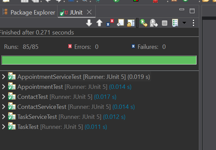
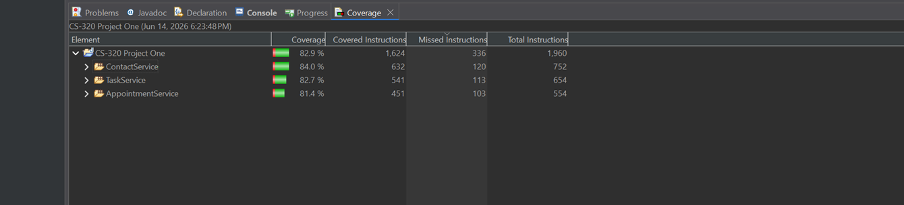

# Java Service Validation · JUnit Testing

Three small Java services for managing contacts, tasks and appointments in memory. The project focuses on turning requirements into field validation and tests, including boundary values, rejected input, duplicate IDs and service operations.

**Available here:** the full source, JUnit tests and a Maven build. **89 tests passed** with Java 17 and Maven.

## What the project demonstrates

The domain classes validate their own data, while the services manage records by ID using `HashMap` storage. That separation keeps the validation in one place and lets the tests exercise both individual objects and service behavior.

| Domain | Main rules and operations |
|---|---|
| Contact | Immutable ID; name and address length limits; exactly ten phone digits; add, retrieve, delete and update fields |
| Task | Immutable ID; name and description length limits; add, retrieve, delete and update fields |
| Appointment | Immutable ID; non-null date that is not in the past when assigned; description length limit; add, retrieve and delete |

Duplicate IDs and missing-record operations are rejected. The tests cover valid inputs as well as values at and beyond the permitted boundaries. Empty strings remain allowed where the original requirements specified only a maximum length and non-null value.

## Run the tests

Install **JDK 17 or newer** and **Apache Maven 3.9 or newer**. From the repository root, run:

```bash
mvn test
```

Maven downloads the pinned build plugins and JUnit dependencies on the first run. No Eclipse project setup is required. Test reports are written to `target/surefire-reports/`.

The source is in [src/main/java](src/main/java), and the tests are in [src/test/java](src/test/java).

## Testing and design

Verified on October 1, 2026 with Java 17 and Maven 3.9.11: **89 tests passed, zero failures, zero errors and zero skipped tests**.

The suite contains 85 original tests and four regression tests for defensive copying of appointment dates. Because `Date` is mutable, the appointment copies dates on assignment and retrieval so callers cannot bypass validation by changing a shared object. The tests cover the constructor, setter, getter, and preservation of the previous value after a rejected update.

<details>
<summary>Earlier Eclipse test and coverage results</summary>

These screenshots show the original 85-test suite with **82.9% overall instruction coverage**. Coverage has not been remeasured for the current 89-test suite.





</details>

## Scope and limitations

The services store records only for the lifetime of the process. They are not persistent or designed for concurrent access. Appointment dates are checked when assigned; an appointment naturally becomes a past appointment as time passes. There is no scheduling, reminder or conflict-detection system.

## Background

I implemented the Contact, Task and Appointment classes and their services, then developed tests around their required behavior and input constraints.

Developed as undergraduate coursework. See [credits and acknowledgments](CREDITS.md).
